<p align="center">
  
</p>

<h1 align="center">CoCo Music</h1>

<p align="center">一个开源的多平台桌面音乐播放器。</p>

<p align="center">
  网易云音乐 · QQ 音乐 · 酷狗音乐 · 酷狗概念版<br />
  macOS · Windows · Linux
</p>

<p align="center">
  <a href="https://github.com/markcxx/cocomusic/releases">下载安装</a> ·
  <a href="#界面预览">界面预览</a> ·
  <a href="#本地开发">本地开发</a> ·
  <a href="https://github.com/markcxx/cocomusic/issues">反馈问题</a>
</p>

<p align="center">
  <a href="https://github.com/markcxx/cocomusic/releases/latest"></a>
  <a href="https://github.com/markcxx/cocomusic/actions/workflows/ci.yml"></a>
  <a href="https://github.com/markcxx/cocomusic/actions/workflows/release.yml"></a>
  <a href="https://github.com/markcxx/cocomusic/releases"></a>
  <a href="LICENSE"></a>
</p>

<p align="center">
  <a href="#下载"></a>
  <a href="package.json"></a>
  <a href="package.json"></a>
  <a href="package.json"></a>
  <a href="package.json"></a>
</p>

## 功能特性

### 多平台曲库与账号

接入网易云音乐、QQ 音乐、酷狗音乐与酷狗概念版，支持推荐歌单、新歌、排行榜、专辑和歌手浏览。歌曲、歌单、专辑与歌手均可搜索，并提供热搜、输入建议、搜索历史和分类筛选。

支持扫码登录，各平台账号独立保存。登录后可同步喜欢的歌曲、访问创建及收藏的歌单，并管理歌单及其中的歌曲。酷狗概念版另支持会员信息查询、每日权益领取与自动签到。

### 歌单与播放

本地歌单可混合收录不同平台歌曲与本地文件，支持分享链接导入，以及将平台歌单、专辑或播放队列保存为本地歌单。切换曲库平台后，已有队列仍按歌曲原始来源播放。

- 顺序播放、随机播放、单曲循环与播放队列管理。
- 在线音质选择、倍速播放、淡入淡出及音频输出设备切换。
- 恢复上次的歌曲、队列与播放位置，支持播放失败自动跳过。
- 歌曲列表搜索与批量操作，可选择双击时播放整个列表或仅插入当前歌曲。

### 歌词与可视化

歌词页提供标准、居中与纯歌词三种布局，支持同步滚动、翻译、点击歌词跳转，以及字号、对齐和时间偏移调整。可选择封面或纯色背景，并自定义歌词与可视化配色。

内置细线频谱、柔光波、镜面倒影、经典唱片、跳动旋律、迷幻水波、动感音阶和星河漫游八种效果。经典唱片可叠加频谱或柔光效果，星河漫游提供独立的三维歌词场景；设备不支持 WebGL 或启用减弱动态效果时可回退到普通歌词。

### 外观与个性化

- **简约**：中性配色与清爽的内容卡片，作为默认界面风格。
- **Fluent**：Windows 11 风格的控件与分层，支持展开、图标栏及覆盖式导航，播放栏配色跟随封面。
- **毛玻璃**：预设主题与自定义背景图，可分别调整图片模糊、遮罩、窗口和面板不透明度。
- **透明窗口**：透出桌面与其他窗口，支持面板底色和模糊调节。

支持浅色、深色、跟随系统、主题色、封面取色、界面缩放与减弱动态效果。自定义背景图仅用于毛玻璃风格，最近选择的图片保存在本机；涉及透明窗口的切换需重启应用后生效。

### 本地音乐与下载

支持文件夹递归扫描、文件拖放与系统「打开方式」，读取音频标签、封面、内嵌歌词及同名歌词文件。本地歌曲可搜索、播放并加入歌单，与在线曲库一起管理。

下载前核验当前账号可用音质，可选择附带歌词、允许试听片段及音质降级。下载管理支持并发、进度、取消与重试，可自定义保存目录和文件命名，写入歌曲信息、封面及同名 `.lrc` 歌词；试听片段会在文件名中标记。

### 评论与 MV

支持歌曲评论、回复，以及推荐、最热和最新排序。歌词页与独立评论页均可查看评论。歌曲关联 MV 支持平台可用清晰度、倍速、画中画和全屏播放，并可在同页查看歌曲评论。

### 桌面集成与数据

迷你播放器保留封面、播放控制与滚动歌词。桌面歌词支持锁定、双行、翻译、逐字高亮，以及颜色、字号、字重和描边调整；macOS 提供菜单栏歌词，Windows 提供带悬停播放控制的任务栏歌词。

支持应用内与全局快捷键、系统托盘、开机启动、后台播放和切歌通知。本地曲库、歌单、下载记录与播放状态使用 SQLite 保存，支持旧数据迁移、备份恢复、应用内更新及更新日志。

音乐内容、音质与账号功能受平台授权限制。系统窗口效果因平台而异，Linux 桌面歌词的置顶与交互能力取决于桌面环境。

## 下载

前往 [Releases](https://github.com/markcxx/cocomusic/releases) 获取安装包。

| 系统 | 架构 | 安装包 |
| --- | --- | --- |
| macOS | Apple Silicon / Intel | DMG、ZIP |
| Windows | x64 | EXE 安装程序 |
| Linux | x64 | AppImage、deb |

安装包尚未进行开发者代码签名，首次打开可能出现系统安全提示。

## 界面预览

### 简约与 Fluent


<details>
<summary>深色模式、Fluent 收起导航与设置页</summary>


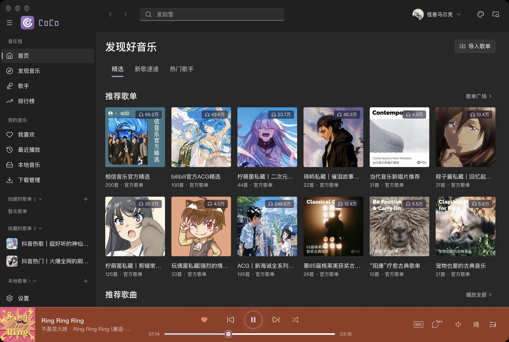


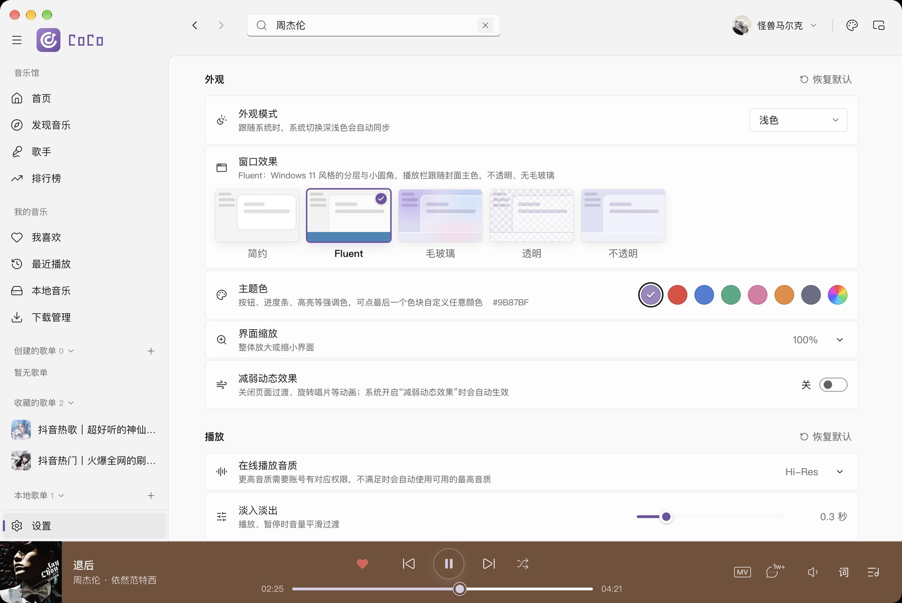

</details>

### 毛玻璃、换肤与背景图

<details>
<summary>毛玻璃风格与换肤</summary>


</details>


### 透明窗口

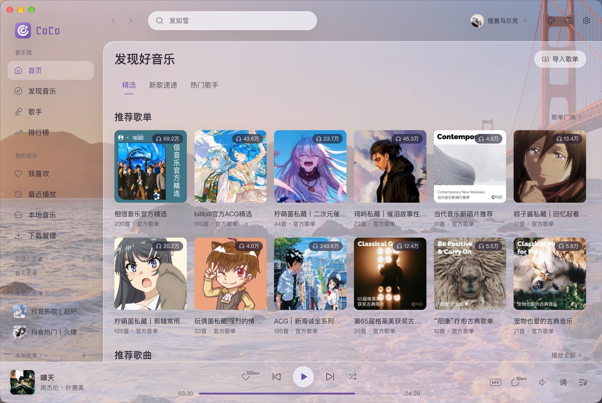

### 歌词布局与可视化


<details>
<summary>居中、纯歌词布局与播放模式面板</summary>


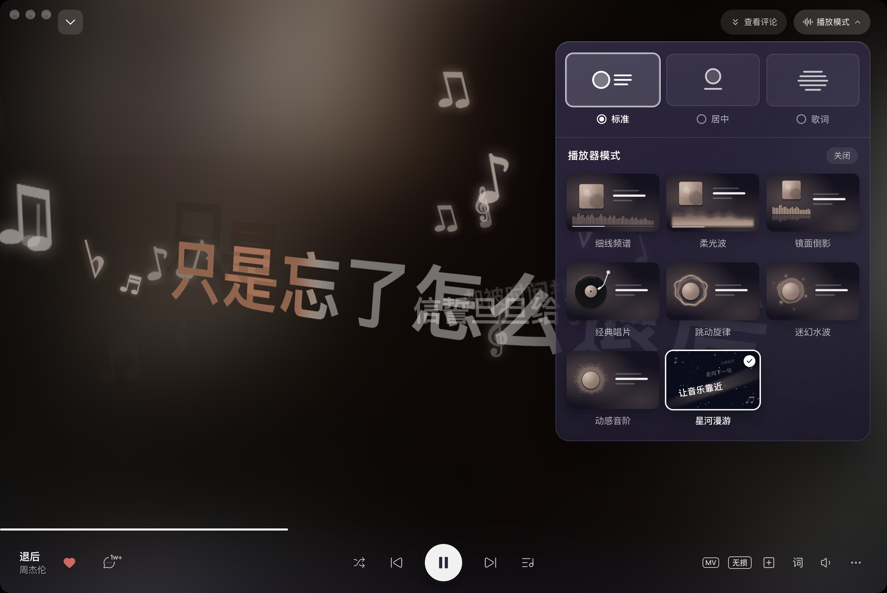

</details>

<details>
<summary>八种可视化效果</summary>

| 细线频谱 | 柔光波 |
| --- | --- |
|  |  |

| 镜面倒影 | 经典唱片 |
| --- | --- |
|  |  |

| 跳动旋律 | 迷幻水波 |
| --- | --- |
|  |  |

| 动感音阶 | 星河漫游 |
| --- | --- |
|  |  |

</details>

### 多平台浏览与搜索

<details>
<summary>平台切换与各平台首页</summary>


</details>

<details>
<summary>发现音乐、新歌速递与排行榜</summary>


</details>

<details>
<summary>歌手目录、歌曲、专辑与简介</summary>


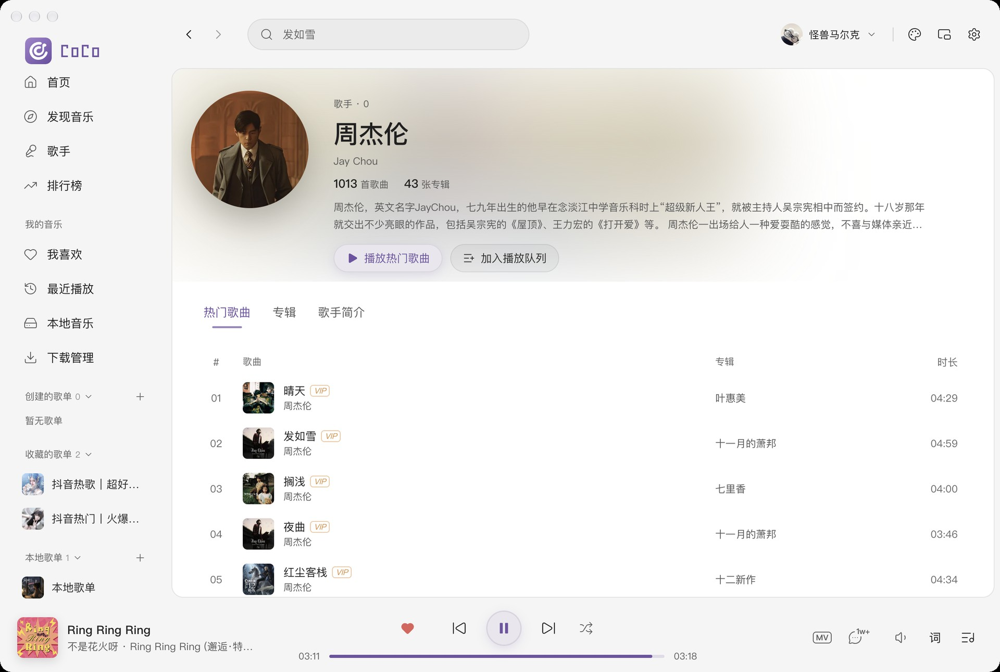


</details>

<details>
<summary>歌曲、歌单、专辑与歌手搜索</summary>

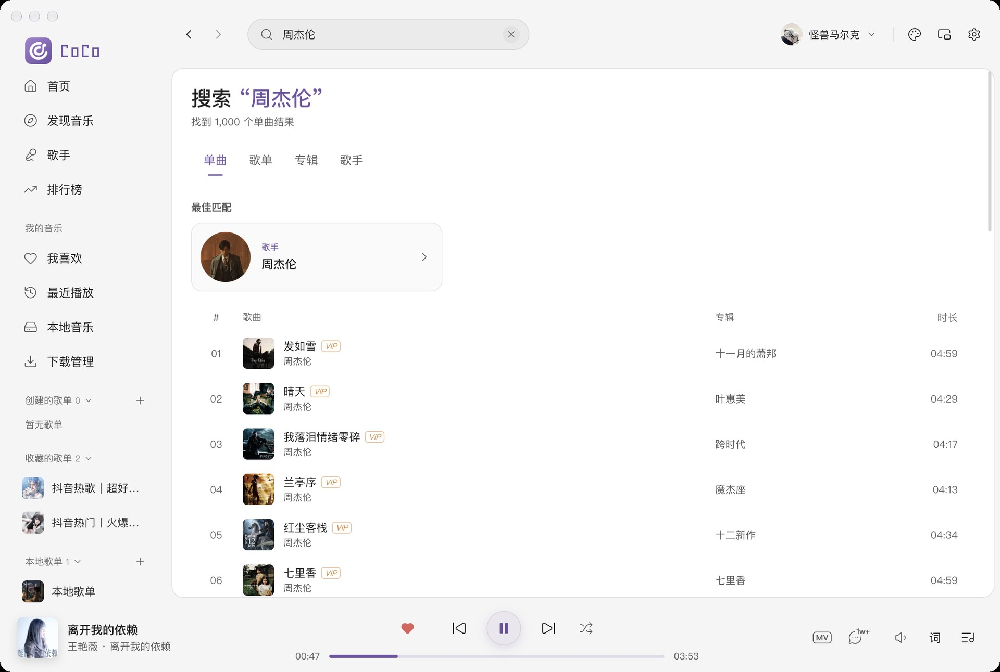


</details>

### 账号、歌单与播放队列

<details>
<summary>账号、概念版权益与喜欢的歌曲</summary>


</details>


<details>
<summary>本地歌单、分享链接导入、队列与最近播放</summary>


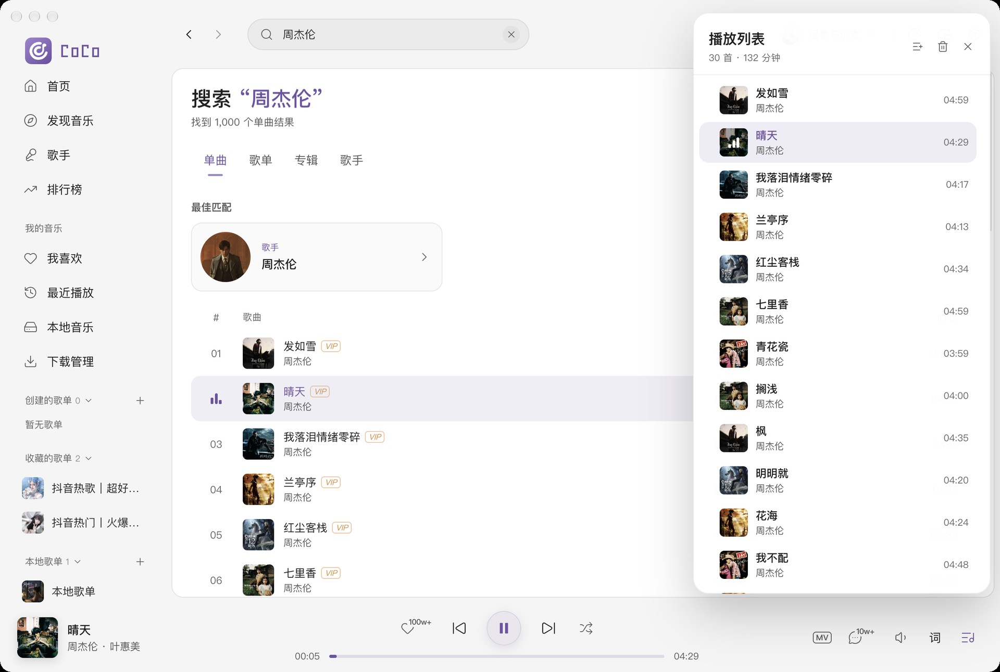

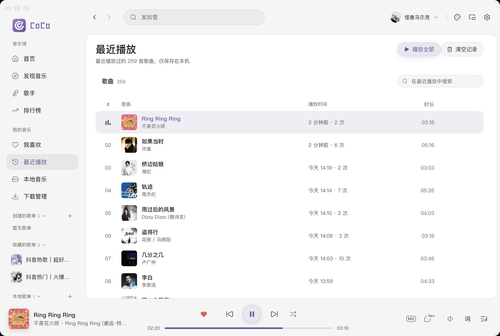

</details>

### 本地音乐、音质与下载

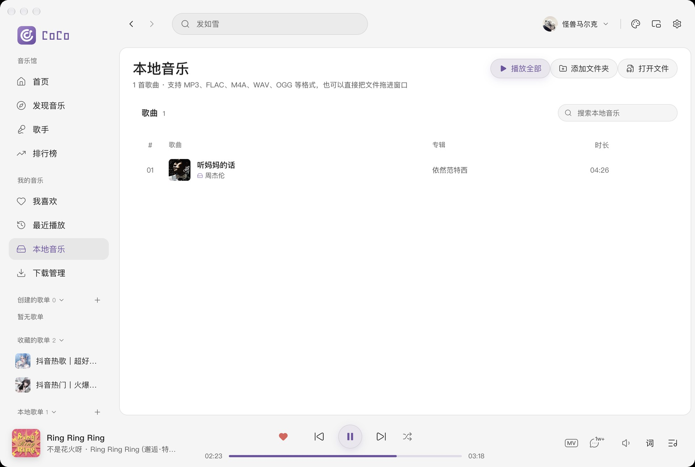

<details>
<summary>下载前选择音质与下载任务管理</summary>


</details>

### 评论与 MV

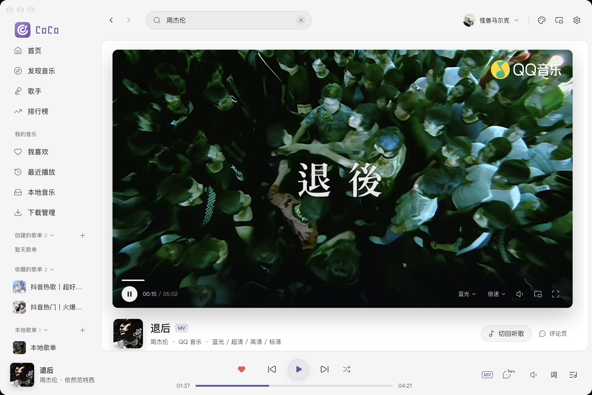

<details>
<summary>独立评论页与歌词页评论</summary>


</details>

### 迷你播放器与桌面歌词


<details>
<summary>桌面歌词、菜单栏歌词与任务栏歌词</summary>


</details>

### 设置分组

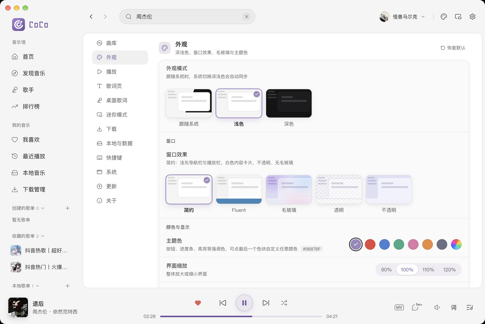

## 本地开发

需要 npm 和符合 [package.json](package.json) 中 `engines.node` 要求的 Node.js。

```bash
git clone https://github.com/markcxx/cocomusic.git
cd cocomusic
npm ci
npm run dev
```

| 命令 | 用途 |
| --- | --- |
| `npm run dev` | 启动桌面开发环境，支持热更新 |
| `npm run dev:web` | 预览网页界面 |
| `npm run typecheck` | 类型检查 |
| `npm run lint` | 代码检查 |
| `npm test` | 运行测试 |
| `npm run build` | 构建应用 |
| `npm run dist:mac` | 打包 macOS 安装包 |
| `npm run dist:win` | 打包 Windows 安装包 |
| `npm run dist:linux` | 打包 Linux 安装包 |

系统窗口、文件选择与全局快捷键等功能需要桌面客户端。各平台安装包通过 GitHub Actions 构建并发布到 Releases。

## 反馈与参与

欢迎提交 [Issue](https://github.com/markcxx/cocomusic/issues) 或 Pull Request。反馈问题时请附上应用版本、操作系统与复现步骤。

## 致谢

感谢 [LINUX DO](https://linux.do/) 社区对开源分享的支持。

## 许可证

本项目采用 [GPL-3.0-only](LICENSE) 协议开源。

CoCo Music 是独立开发的第三方客户端，与所接入平台无官方隶属或合作关系。音乐、封面及歌词等内容归各自权利人所有；播放范围和音质取决于平台授权、账号权益及地区限制。
