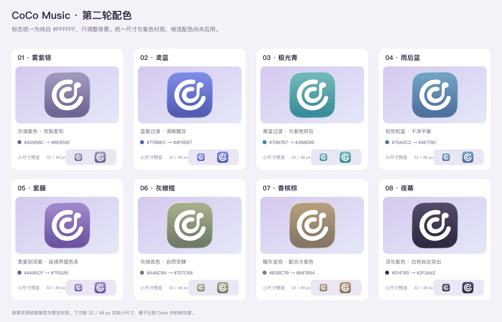

# 图标配色候选

本轮已选用 05「紫藤」作为正式配色，其余方案保留作设计参考。标志固定为纯白色 #FFFFFF，保持修正后的 Dock 尺寸，只调整背景颜色。

| 编号 | 名称 | 背景色 | 标志色 | 方向 |
| --- | --- | --- | --- | --- |
| 01 | 雾紫银 | #A095BC → #6E6592 | #FFFFFF | 灰调紫色 · 克制柔和 |
| 02 | 鸢蓝 | #778BEC → #4F5EB7 | #FFFFFF | 蓝紫过渡 · 清晰醒目 |
| 03 | 极光青 | #70B7B7 → #388D99 | #FFFFFF | 青蓝过渡 · 与紫色呼应 |
| 04 | 雨后蓝 | #70A0C2 → #4E719C | #FFFFFF | 低饱和蓝 · 干净平衡 |
| 05 | 紫藤 | #A485CF → #7152A5 | #FFFFFF | 柔紫到深紫 · 延续界面色系 |
| 06 | 灰橄榄 | #A4AC8A → #707C68 | #FFFFFF | 灰绿底色 · 自然安静 |
| 07 | 香槟棕 | #B39C7B → #847664 | #FFFFFF | 暖灰金棕 · 配合冷紫色 |
| 08 | 夜幕 | #514765 → #2F2A42 | #FFFFFF | 深灰紫色 · 白色标志突出 |

使用 `node scripts/preview-icon-colors.mjs` 重新生成，需要 Xcode 的 Icon Composer 工具。
